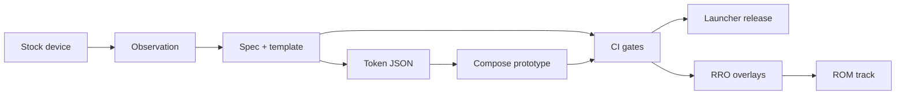

<div align="center">

# OpenStock

**One open Android experience that speaks every stock OS.**

    

[](https://github.com/adineo-cmd/openstock/stargazers) [](https://github.com/adineo-cmd/openstock/commits)

[Quick start](#quick-start) · [How it works](#how-it-works) · [Features](#features)

</div>

---

A clean-room reimplementation of the signature UX of the major Android skins —
Xiaomi **HyperOS**, OPPO/OnePlus **ColorOS**, realme UI and Samsung **One UI** —
built with original Kotlin and original assets on top of AOSP.

**Twelve implementation-ready specs**, three token files, and a prototype
launcher that renders all three skins from the same component set.

## Features

| | Feature | What it does |
| --- | --- | --- |
| 📐 | **Spec-first** | Every surface is documented before it is built, from observable behaviour only. |
| 🎨 | **Token parity** | Colours, radii, grids and motion curves live in `specs/tokens/*.json` and are applied verbatim. |
| 🧩 | **AOSP-shaped** | Panels mirror upstream SystemUI structure, so app knowledge transfers to the ROM track. |
| ✅ | **Legal and CI gates** | CI fails on decompiled-output markers, stale badges, stale diffs or ungenerated resources. |

## How it works

The project takes the only path that survives a licence review:

1. **Observe** a stock OS on a device — layouts, timings, curves, gestures.
2. **Spec** it in `specs/` using the standard template.
3. **Implement** with original Kotlin/AOSP code and original artwork.
4. **Ship** as a launcher first, then as RRO overlays and a ROM track.

Tooling keeps the specs honest: `tokens-check.py` validates token schemas,
`coverage.py` regenerates the coverage badge, `skindiff.py` diffs two skins, and
`gen-rro.py` generates overlay resources.



## Quick start

Android Studio with a recent Android SDK, or a local Gradle install. Python 3.12 for the tooling.

**Prototype app**

```bash
# open stock/app in Android Studio
cd app
# or, with a local Gradle install:
gradle :app:assembleDebug
```

**Spec and token checks**

```bash
python3 -I tools/tokens-check.py
python3 -I tools/coverage.py --check
python3 -I tools/skindiff.py coloros hyperos --check docs/diffs/coloros-vs-hyperos.md
python3 -I tools/gen-rro.py --check
```

## Project structure

```text
app/               Gradle root for the launcher prototype
  app/src/main/java/com/openstock/launcher/
    skin/           Skin interface and spec model
    skins/          HyperOS, ColorOS, One UI implementations
    ui/             Panel scaffold, tiles, cards, home screen
specs/             one spec per surface, plus TEMPLATE.md
specs/tokens/      colour, shape and motion tokens per skin
docs/              methodology, glossary, feature matrix, diffs
rom/overlays/      RRO overlay track
tools/             token, coverage, diff and RRO generators
LEGAL.md           what may and may not enter the repository
```

## Fidelity policy

Everything measurable matches exactly. Artwork never copies.

- **Copied:** timings, easing curves, grids, tile sizes, corner radii, motion
  physics — all captured as numbers.
- **Original:** icons, wallpapers, fonts and sounds, drawn in the *style* of each
  skin.
- **Copied structure:** the underlying SystemUI architecture, because every vendor
  skin is itself a fork of Apache-licensed AOSP.

That is the legal ceiling for an open-source clone, and the spec process is built
to sit exactly on it.

## What the CI enforces

| Gate | Failure means |
| --- | --- |
| Decompiled-output scan | A `jadx`/smali artefact reached the tree |
| Token schema + cross-spec check | Two specs disagree about the same token |
| Coverage badge freshness | The published number no longer matches the specs |
| Skin diff freshness | A diff report is out of date |
| Generated RRO freshness | Committed overlays do not match their source |

## License

Apache-2.0. See [LICENSE](LICENSE) and read [LEGAL.md](LEGAL.md) before contributing.
