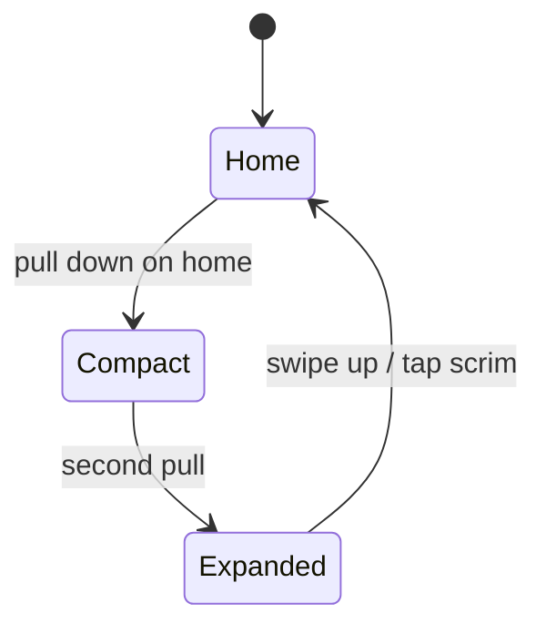

# SC-<OS>-<NNN>: <Feature name>

| Field          | Value |
|----------------|-------|
| **ID**         | SC-<OS>-<NNN> |
| **Source OS**  | <HyperOS 3.1 / ColorOS 17 / realme UI 8 / One UI 8.5> |
| **Status**     | draft / stable / implemented |
| **Priority**   | P0 (iconic) / P1 (important) / P2 (nice to have) |
| **OpenStock skin** | `<skin-name>` |
| **Implements** | — |

## 1. Summary

One paragraph: what the user sees and does. No code, no vendor asset references.

## 2. Behavioral states

Describe each UI state and every transition. Mermaid allowed:

## 3. Parameters

The numbers. Every value carries a unit and a confidence marker (`exact` or `~`).

| Parameter             | Value                          | Confidence |
|-----------------------|--------------------------------|------------|
| Panel width           | full screen                    | exact      |
| Panel corner radius   | 28 dp (bottom corners)         | ~          |
| Tile grid             | 4 columns, 44 dp gap           | ~          |
| Tile size             | 64 dp circle                   | ~          |
| Open animation        | 280 ms, spring, damping 0.82   | ~          |
| Scrim opacity         | 0→0.42 over 200 ms             | ~          |

## 4. Interaction details

- Gesture surfaces and thresholds (dp of drag before intent is recognized).
- Long-press behavior, double-tap behavior.
- Haptics (pattern, intensity).
- What happens on interruption (call arrives mid-animation, rotation, etc.).

## 5. Visual language notes

Colors as roles (not vendor hex): panel background is a *translucent neutral glass*,
active tiles use *accent color*, disabled use *neutral-40*. Typography roles and weights.
(Original hex values are chosen by the implementation, not the spec.)

## 6. Accessibility & edge cases

- TalkBack semantics per element.
- Font-scale 1.0→2.0 behavior.
- Landscape / tablet / foldable behavior.
- RTL mirroring rules.

## 7. Verification

How a reviewer confirms parity from the spec alone. Checklist form.

## 8. Provenance

- Observed on: <device model>, <OS version>, <date>
- Method: <slow-mo screen recording at 240fps; measured with frame counter>
- Notes: any patent-review flags, open questions, TODO measurements.
