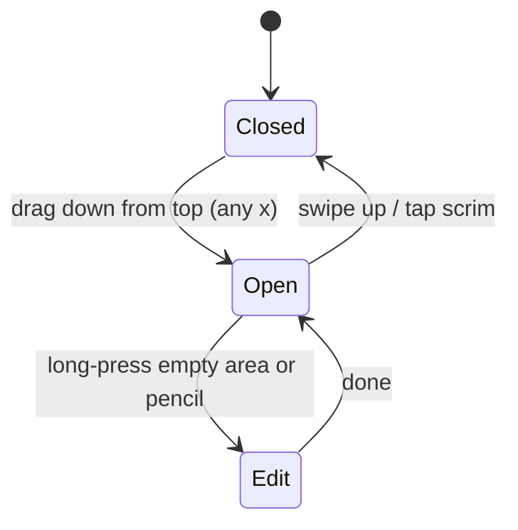

# SC-CO-001: ColorOS-style Quick Settings (circular toggles, luminous glass)

| Field          | Value |
|----------------|-------|
| **ID**         | SC-CO-001 |
| **Source OS**  | ColorOS 16/17 (observed behavior) |
| **Status**     | stable |
| **Priority**   | P0 (iconic) |
| **OpenStock skin** | `coloros` |
| **Implements** | matrix rows #1, #4, #30 |

## 1. Summary

A **single-stage** quick-settings panel: one swipe from the top opens the full panel.
The core grid is **circular toggles arranged in 4 columns**, visually centered, above a
full-width brightness slider. Notifications share the panel below the grid. The panel
uses a "luminous glass" background — translucent with a soft light-bleed gradient that
makes edges glow subtly. Recent ColorOS 17 builds tighten spacing and lighten the glass.

## 2. Behavioral states

- **Open**: circular tile grid (2 rows visible of 4 columns, more rows by scroll),
  then brightness slider, then media, then notifications list.
- **Edit**: grid enters reorder mode; unused tiles appear in a bottom drawer;
  drag between drawer and grid.

## 3. Parameters

| Parameter                | Value                            | Confidence |
|--------------------------|----------------------------------|------------|
| Trigger threshold        | ≥ 32 dp downward drag, any top-x | ~          |
| Panel height (open)      | 100% (notifications reachable)   | ~          |
| Tile shape               | circle, 56 dp diameter           | ~          |
| Tile columns             | 4                                | exact      |
| Tile gap                 | 16 dp horizontal, 20 dp vertical | ~          |
| Active tile fill         | accent, full circle              | ~          |
| Inactive tile            | neutral glass fill, no border    | ~          |
| Brightness slider        | 40 dp height, 24 dp corner, full width | exact|
| Luminous glass           | neutral @ 66% + top-edge light bleed (white @ 12%, fades over 120 dp) | ~ |
| Open animation           | 320 ms, ease-out-quint, no overshoot | ~     |
| Scrim                    | 0 → 0.35 over 240 ms             | ~          |
| Edit-mode wiggle         | ±1.5° at 0.9 s period            | ~          |

## 4. Interaction details

- No two-stage behavior: one continuous drag maps to panel position (drag-follow,
  release with velocity decides settle state).
- Tile press feedback: scale to 0.92, release springs back (180 ms).
- Media card: 72 dp tall, rounded 24 dp, sits between slider and notifications.
- Quick gestures: swipe down on the notifications region while the grid is showing
  scrolls the notification list; two-finger pull jumps straight to full expand.

## 5. Visual language notes

- "Luminous" = a vertical light gradient at the panel's top edge and a faint outer glow
  on active tiles (accent @ 24% alpha, 12 dp blur). Restraint: only the top 120 dp glows.
- Text on panel: primary 15 sp w5; timestamps 12 sp w4 @ 60% opacity.
- realme UI delta (see [realme-ui-notes.md](realme-ui-notes.md)): same layout, warmer
  accent default, no top-edge light bleed.

## 6. Accessibility & edge cases

- TalkBack: circular tiles announce state + actions; edit mode announces reorder hints.
- 3-column fallback at font scale > 1.3 (tiles grow to 64 dp).
- Landscape: panel is a centered sheet, 70% width, 6 columns.

## 7. Verification

- [ ] Single-stage drag-follow open (no intermediate stop).
- [ ] Circles, not rounded squares; 4 columns; centered grid.
- [ ] Light-bleed gradient present at top edge only.
- [ ] No overshoot on open; press-scale feedback on tiles.

## 8. Provenance

- Observed on: public ColorOS 16/17 and realme UI 7/8 reviews, vendor community posts,
  2026-11.
- Method: behavioral synthesis from public materials; awaiting first-party measurement.
- Notes: circular-toggle grids are a long-established cross-vendor pattern; no
  patent-review flag.
