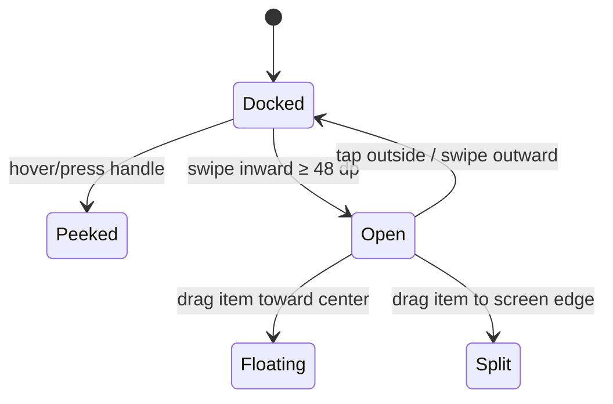

# SC-CO-002: Smart Sidebar (edge drawer)

| Field          | Value |
|----------------|-------|
| **ID**         | SC-CO-002 |
| **Source OS**  | ColorOS 16/17 (observed behavior; Edge Panels for comparison) |
| **Status**     | draft |
| **Priority**   | P1 |
| **OpenStock skin** | `coloros` |
| **Implements** | matrix row #12 |

## 1. Summary

A translucent handle docked on the screen's right edge; swiping it inward opens a vertical
strip of app shortcuts and quick tools that float **over any app**. Dragging an item out of
the strip opens it in a floating window or split-screen pair.

## 2. Behavioral states

## 3. Parameters

| Parameter             | Value                        | Confidence |
|-----------------------|------------------------------|------------|
| Handle                | 4 dp × 72 dp pill, right edge, vertically centered | ~ |
| Handle hit slop       | 24 dp                        | ~          |
| Open threshold        | ≥ 48 dp inward drag          | ~          |
| Strip width           | 64 dp, full height minus 32 dp insets | ~ |
| Strip items           | 40 dp icons, 12 dp vertical gap, max 9 + toolbox | ~ |
| Open animation        | 260 ms, ease-out, strip slides 24 dp from edge with fade | ~ |
| Floating window drop  | item dragged past 35% screen width → window opens at drop point | ~ |
| Split trigger         | item dragged to left/right edge zone (48 dp) | ~ |

## 4. Interaction details

- The strip is **contextual**: top section is user-pinned apps; bottom "toolbox" has
  screenshot, screen-record, translate — configurable.
- Handle hides during full-screen video/games (setting-controlled), returns on edge
  long-press.
- Items opened via drag persist their position across opens (floating windows).

## 5. Visual language notes

- Strip: glass surface (neutral @ 70%), items have no labels until long-press
  (tooltip bubble).
- One UI's Edge Panels solve the same *idea* with paginated, wider panels — the
  `oneui` skin reuses this primitive with different pagination parameters.

## 6. Accessibility & edge cases

- TalkBack: handle = "Smart sidebar, double-tap to open".
- RTL: docks left; swipe directions mirror.
- Foldables: strip follows the fold's inner-screen edge.

## 7. Verification

- [ ] Handle visible on home + in apps; opens over any foreground app.
- [ ] Drag-out produces floating window; edge-drag produces split.
- [ ] Handle hides in immersive video, returns on long-press.

## 8. Provenance

- Observed on: public ColorOS/realme UI feature documentation and reviews, 2026-11.
- Method: behavioral synthesis. Notes: side-edge tool drawers are an established
  pattern (also Samsung Edge Panels, earlier Android edge gestures); no patent-review flag.
