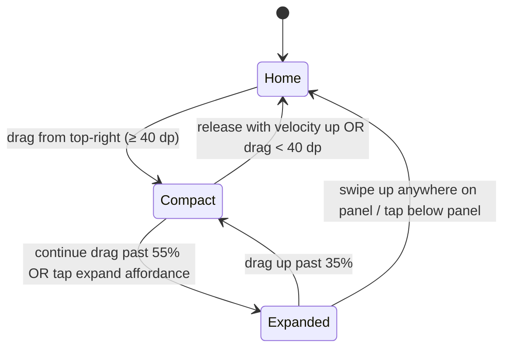

# SC-HX-001: HyperOS-style Control Center (two-stage glass panel)

| Field          | Value |
|----------------|-------|
| **ID**         | SC-HX-001 |
| **Source OS**  | HyperOS 3.1 (observed behavior) |
| **Status**     | stable |
| **Priority**   | P0 (iconic) |
| **OpenStock skin** | `hyperos` |
| **Implements** | matrix row #1, #2, #4 |

## 1. Summary

A translucent "glass" quick-settings panel summoned by swiping down from the top-right of
the screen. The pull is **two-stage**: the first stage reveals a compact panel with a small
tile grid plus inline brightness and media controls; the second stage (a further pull or a
swipe on the panel) expands it to the full glass sheet with a wider tile grid and a
notification list appended below. Swiping down from the top-**left** opens the notification
shade instead — the two surfaces are deliberately separate.

## 2. Behavioral states

- **Compact**: 2×4 tile grid (8 tiles), brightness slider, one media card. Height ≈ 42%
  of screen. Tiles are rounded squares, not circles.
- **Expanded**: 3×4 tile grid, brightness + volume sliders, media card, then notifications
  inline below, then a "settings" gear row pinned at bottom. Full height minus ~12 dp inset.
- Panel floats over the home screen with a **scrim behind it**; home content blurs slightly.

## 3. Parameters

| Parameter                    | Value                                   | Confidence |
|------------------------------|-----------------------------------------|------------|
| Shade trigger threshold      | ≥ 40 dp downward drag from top edge     | ~          |
| Compact→Expanded threshold   | drag past 55% of full height, or fling  | ~          |
| Panel width                  | full screen width minus 2×12 dp inset   | ~          |
| Panel corner radius          | 28 dp, all four corners                 | ~          |
| Tile grid (compact)          | 4 columns × 2 rows                      | exact      |
| Tile grid (expanded)         | 4 columns × 3+ rows                     | exact      |
| Tile size                    | 64 dp square, 16 dp corner radius       | ~          |
| Tile gap                     | 12 dp                                   | ~          |
| Tile icon size               | 24 dp                                   | ~          |
| Tile active fill             | accent color, icon flips to on-contrast | ~          |
| Glass background             | neutral, ~72% opacity + background blur | ~          |
| Open animation               | 300 ms spring, damping ≈ 0.8 (slight overshoot) | ~   |
| Scrim                        | 0 → 0.40 black over 220 ms              | ~          |
| Brightness slider height     | 44 dp, full panel width minus padding   | exact      |
| Media card                   | rounded 20 dp, thumbnail 56 dp left     | ~          |
| Long-press tile              | opens tile's settings page (or toast if none) | exact|

## 4. Interaction details

- **Gesture ownership**: top-right 50% of the status bar drag → control center;
  top-left 50% → notification shade. A drag starting within 16 dp of the vertical
  midpoint follows the horizontal half it began in.
- Long-press on empty panel area → edit mode: tiles enter a wiggle state, can be
  reordered by drag; a drawer at the bottom offers the full tile palette.
- Toggling a connectivity tile emits a short haptic tick (~8 ms, light).
- Interruption: incoming-call banner while panel open → panel springs down immediately
  (150 ms, no scrim fade-out delay).

## 5. Visual language notes

- Panel background: *translucent neutral glass* — the home screen stays faintly visible
  behind it, heavily blurred.
- Active tiles: *accent fill*; inactive: *neutral-on-glass outline*; disabled: 38% opacity.
- Typography: panel has no headline; settings row label is caption weight (400, 12 sp).
- Motion character: springs everywhere, nothing linear; the panel *lands*, it doesn't stop.

## 6. Accessibility & edge cases

- TalkBack: panel announces "Quick settings, expanded/collapsed"; tiles announce
  "<name>, <on/off>, double-tap to toggle, long-press for settings".
- Font scale up to 1.3 keeps 4-column grid; above that, tiles wrap to 3 columns.
- Landscape: panel becomes a right-anchored sheet, 60% width, tiles 3 columns.
- RTL: left/right gesture halves mirror; tile order mirrors.

## 7. Verification

- [ ] Two-stage pull works with distinct stop points and different tile grids.
- [ ] Top-left drag opens notification shade, not CC.
- [ ] Long-press enters reorder; order persists.
- [ ] Panel springs (overshoots ~4% then settles) on open.
- [ ] Scrim tap-dismiss; swipe-up dismiss with velocity.

## 8. Provenance

- Observed on: community-documented behavior of HyperOS 3 / 3.1 Control Center,
  cross-checked against vendor support pages and public reviews (multiple devices),
  2026-11.
- Method: behavioral synthesis from public video walkthroughs and written descriptions;
  values marked `~` await first-party measurement — contributors with a HyperOS 3.1
  device should file measurement PRs.
- Notes: interaction pattern (two-stage shade, glass tiles) is a widely duplicated,
  unpatented pattern. No patent-review flag.
