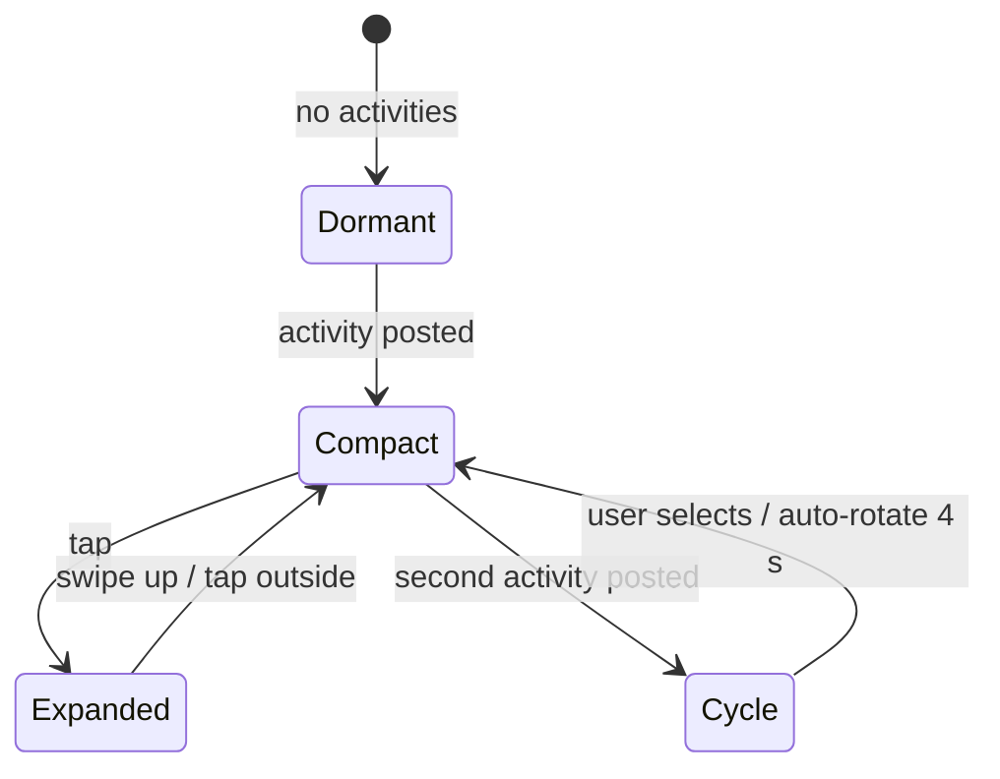

# SC-HX-002: HyperIsland (system live-activity pill)

| Field          | Value |
|----------------|-------|
| **ID**         | SC-HX-002 |
| **Source OS**  | HyperOS 3.x (observed behavior) |
| **Status**     | draft |
| **Priority**   | P0 (iconic) |
| **OpenStock skin** | `hyperos` |
| **Implements** | matrix row #5, #6 |

## 1. Summary

A pill-shaped live-activity surface that wraps the front-camera cutout in the status bar.
When an app posts an ongoing activity (timer, music, navigation, recording), the cutout
area **grows horizontally** into a pill containing a compact activity card; tapping it
expands into a floating card over the current app; long-pressing shows the activity's
full controls. Multiple concurrent activities cycle in the pill.

## 2. Behavioral states

- **Compact**: pill hugs the cutout, width = cutout + card content + 16 dp padding.
  Content: 20 dp icon + primary text, single line, ellipsized.
- **Expanded**: card detaches, drops 8 dp, expands to ~70% screen width with full
  controls (e.g., playback buttons). Background of the card matches activity's theme
  color (soft, not saturated).
- **Cycle**: two+ activities → pill shows the newest; a small counter dot appears;
  tapping the dot cycles; auto-rotate every ~4 s when untouched.

## 3. Parameters

| Parameter                | Value                          | Confidence |
|--------------------------|--------------------------------|------------|
| Pill height (compact)    | status-bar height (~36 dp)     | ~          |
| Pill corner radius       | fully rounded (height/2)       | exact      |
| Grow animation           | 380 ms spring, damping 0.75 (notable overshoot) | ~ |
| Shrink animation         | 260 ms spring, damping 0.9     | ~          |
| Expanded card radius     | 24 dp                          | ~          |
| Auto-cycle interval      | ~4 s                           | ~          |
| Appear haptic            | none (silent appear)           | ~          |

## 4. Interaction details

- Activities declare: icon, short label, theme color, tap target, control set
  (0–4 actions), and whether they're "persistent" (survive dismiss) or transient.
- Swipe up on expanded card → activity minimized back to pill; swipe up on compact
  pill → activity dismissed (with confirm haptic if persistent).
- On lock screen, the same activity renders as a **lockscreen card** (matrix row #6):
  full width, top-aligned under the clock, same content model.
- Interruption: full-screen video → pill hides, small dot indicator remains; on exit
  the pill re-grows.

## 5. Visual language notes

- Pill/card background: soft glass tinted by the activity theme color (≤ 24% saturation
  influence). Text: high-contrast on-glass. The pill never draws attention with motion
  after it settles — motion only on state *changes*.

## 6. Accessibility & edge cases

- TalkBack: pill announces "<activity>, <label>, expanded state, double-tap to expand".
- Pill content must never obscure the status bar icons: pill grows *around* them.
- No-cutout devices: pill docks at the top-center as a floating capsule instead.
- Font scale: text truncates, icon stays 20 dp; expanded card reflows to 2 lines.

## 7. Verification

- [ ] Pill grows/shrinks with spring overshoot matching parameters.
- [ ] Two activities auto-cycle; manual cycle via dot works.
- [ ] Expanded card keeps activity controls functional.
- [ ] Lockscreen card mirrors the same activity without re-implementation.

## 8. Provenance

- Observed on: public HyperOS 3.x reviews and community documentation, 2026-11.
- Method: behavioral synthesis; awaiting first-party frame-rate measurements.
- Notes: live-activity pills are now a cross-vendor pattern (iOS Dynamic Island,
  Fluid Cloud, Now Bar). OpenStock implements the *idea* once with per-skin styling.
