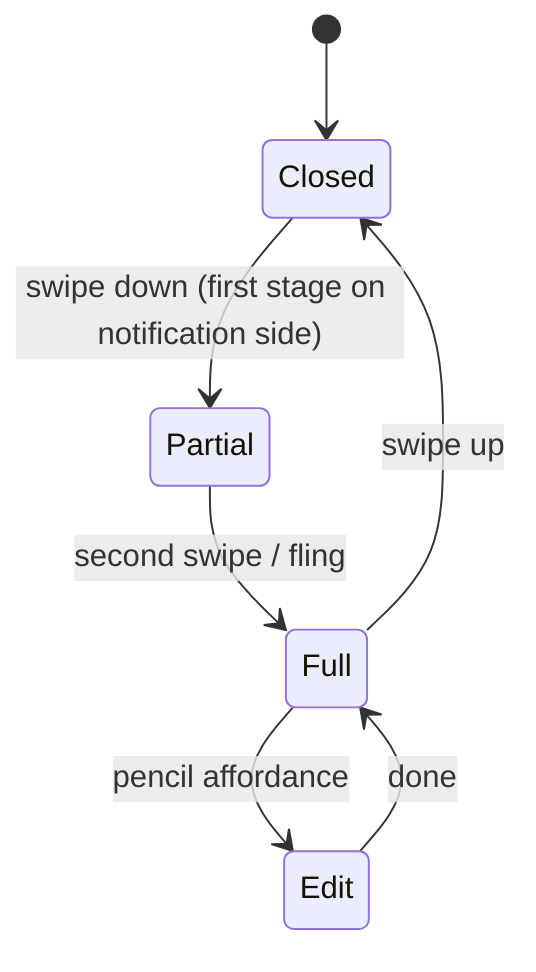

# SC-OU-001: One UI-style Quick Panel (bottom-anchored, customizable grid)

| Field          | Value |
|----------------|-------|
| **ID**         | SC-OU-001 |
| **Source OS**  | One UI 8.x / 8.5 (observed behavior) |
| **Status**     | stable |
| **Priority**   | P0 (iconic) |
| **OpenStock skin** | `oneui` |
| **Implements** | matrix rows #1, #4, #30 |

## 1. Summary

A quick-settings panel that is **bottom-anchored**: circular toggle buttons live in the
lower half of the panel so they're reachable one-handed, with the brightness slider
below them and *large-type headers* anchoring each section. One UI 8.5 adds deep
customization — toggles, sliders, and volume controls can be **resized and repositioned**
in an edit mode. Two swipe styles exist: one swipe on the right side opens the panel
fully; the left side opens notifications (sides are configurable).

## 2. Behavioral states

- **Full**: bottom block = grid of circular toggles (3 columns default), then brightness
  slider, then media. Above (reachable only two-handed): large header text, date,
  carrier chip, and settings/power buttons row.
- **Edit**: drag toggles to reorder/resize (1×1 ↔ 1×2), move brightness/volume blocks;
  "advanced" list holds unused toggles.

## 3. Parameters

| Parameter               | Value                             | Confidence |
|-------------------------|-----------------------------------|------------|
| Panel height (full)     | 100%                              | exact      |
| Toggle grid anchor      | bottom, ~55% down-screen on 6.5"  | ~          |
| Toggle shape            | circle, 52 dp, icon 22 dp         | ~          |
| Grid columns            | 3 default (4 compact setting)     | exact      |
| Toggle gap              | 20 dp                             | ~          |
| Active toggle           | accent fill + white icon          | ~          |
| Inactive toggle         | neutral glass fill, no border     | ~          |
| Brightness slider       | 44 dp, below grid, 26 dp radius   | exact      |
| Header type             | 24–26 sp / w6, left-aligned       | ~          |
| Open animation          | 260 ms, ease-out-cubic            | ~          |
| Scrim                   | 0 → 0.5 over 200 ms (strong dim)  | ~          |
| Edit resize step        | toggle 52 → 104 dp (1×2)          | ~          |

## 4. Interaction details

- Side-swap: settings let users flip which side opens notifications vs panel.
- Toggles flip on tap; label under the circle (12 sp).
- Panel pulls with **drag-follow** and settles by release velocity; no bounce.
- Interruptions (edge swipes back etc.) cancel the panel at any drag position.

## 5. Visual language notes

- Flat neutral glass (less blur than hyperos/coloros), strong scrim, generous vertical
  rhythm. Big type is the brand cue: the panel reads top-down like a page.
- Accent is restrained: only active toggles and the slider fill use it.

## 6. Accessibility & edge cases

- TalkBack: grid announces "3 columns, N toggles"; edit mode provides move/resize actions.
- One-handed reachability (the whole point): grid center must land in the bottom-60%
  thumb arc on all supported aspect ratios.
- Landscape: panel left/right sheet, grid 4 columns.

## 7. Verification

- [ ] Toggle grid occupies lower half; header zone on top.
- [ ] Edit mode supports reorder + 1×1↔1×2 resize of toggles.
- [ ] Side mapping (panel vs notifications) is configurable and enforced.

## 8. Provenance

- Observed on: public One UI 8/8.5 reviews, vendor community documentation, 2026-11.
- Method: behavioral synthesis; awaiting device measurement for exact anchors.
- Notes: bottom-weighted layouts predate One UI and are unpatented interaction practice.
