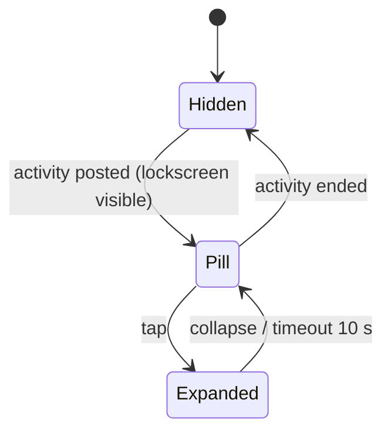

# SC-OU-002: Now Bar (lockscreen live-activity pill)

| Field          | Value |
|----------------|-------|
| **ID**         | SC-OU-002 |
| **Source OS**  | One UI 8.x/8.5 (observed behavior) |
| **Status**     | draft |
| **Priority**   | P1 |
| **OpenStock skin** | `oneui` |
| **Implements** | matrix rows #5, #6 |

## 1. Summary

A pill-shaped live-activity surface shown **on the lock screen above the bottom shortcut
row**, plus an optional ambient pill on the AOD. Ongoing activities (music, timer,
recorder, flashlight state) render as expandable cards. Tapping expands the activity
inline; long-press offers quick controls without unlock (policy-permitted actions only).

## 2. Behavioral states

- **Pill**: single line, rounded full; content per activity (icon + label + live value).
- **Expanded**: pill grows to a card (~160 dp height) with controls; stays expanded
  until dismissed or a 10 s interaction timeout.

## 3. Parameters

| Parameter          | Value                       | Confidence |
|--------------------|-----------------------------|------------|
| Pill height        | 44 dp                       | ~          |
| Pill anchor        | 24 dp above bottom shortcut row | ~      |
| Corner radius      | fully rounded (h/2)         | exact      |
| Expand animation   | 280 ms ease-out-cubic       | ~          |
| Card radius        | 26 dp                       | ~          |
| Interaction timeout| 10 s → auto-collapse        | ~          |
| AOD ambient form   | 32 dp mini-pill, monochrome | ~          |

## 4. Interaction details

- Activities declare the same content model as SC-HX-002 (OpenStock unifies these:
  one `LiveActivity` primitive, three skins). Differences here are **placement and
  policy**: lockscreen-first, unlock-gated controls for sensitive actions.
- Multiple activities stack vertically (max 3); overflow collapses to a counter.

## 5. Visual language notes

- Pill on lock: neutral glass @ 80%; live value uses accent-tinted text. AOD form is
  strictly monochrome to respect low-power displays.

## 6. Accessibility & edge cases

- TalkBack: "Now bar, <activity>, <value>, double-tap to expand".
- Sensor-gated visibility (pocket) to prevent accidental expansion.
- Landscape: pill docks bottom-center, same anatomy.

## 7. Verification

- [ ] Pill appears only on lock/AOD surfaces; expands with tap; times out.
- [ ] Sensitive controls require unlock (per device policy flags).
- [ ] Max 3 stacked, overflow counter works.

## 8. Provenance

- Observed on: public One UI 8.x/8.5 coverage incl. Now Bar feature reports, 2026-11.
- Method: behavioral synthesis.
- Notes: shares the SC-HX-002 content model by OpenStock design (one primitive, three skins).
