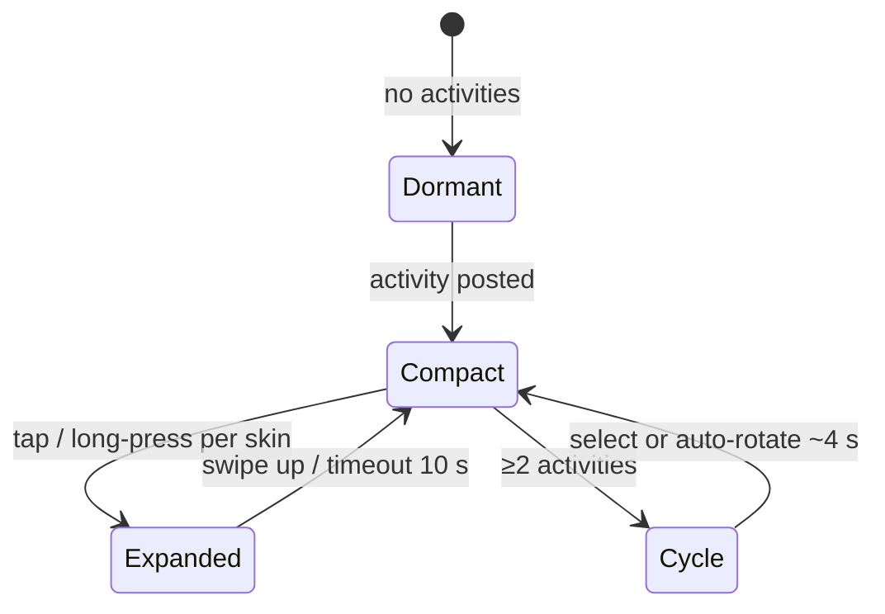

# SC-OS-001: LiveActivity — the unified live-activity primitive

| Field          | Value |
|----------------|-------|
| **ID**         | SC-OS-001 |
| **Source OS**  | OpenStock original (unifies the *idea* behind SC-HX-002 HyperIsland, SC-OU-002 Now Bar, and ColorOS's fluid-cloud-style cards) |
| **Status**     | stable |
| **Priority**   | P0 |
| **OpenStock skin** | all skins |
| **Implements** | matrix rows #5, #6 |

## 1. Summary

OpenStock's unique primitive: **one** live-activity content model and one state machine,
presented three different ways by three skins. Vendors each built their own island/bar/card
implementation of the same concept; OpenStock implements the concept once. Apps post a
`LiveActivity`; the active skin decides where and how it renders.

## 2. Content model (shared, skin-independent)

```text
LiveActivity {
  id: string                  // stable per activity
  icon: glyph                 // 20 dp, monochrome-capable
  shortLabel: string          // single line, ellipsized
  liveValue: string?          // e.g. "0:42", "5.2 km" — updated in place
  themeColor: colorRole       // soft tint influence only (≤24% saturation per SC-HX-002 §5)
  controls: [0..4] Action     // icon + label + intent; sensitive actions flagged
  sensitive: bool             // controls require unlock (device policy may raise this)
  persistent: bool            // survives swipe-dismiss attempt (confirm haptic if true)
}
```

## 3. State machine (shared)



## 4. Per-skin presentation (the ONLY part skins own)

| Skin      | Compact form                          | Expanded form            | Placement notes (per SC-HX-002 / SC-OU-002) |
|-----------|----------------------------------------|--------------------------|---------------------------------------------|
| `hyperos` | Pill wrapping the camera cutout        | Floating card, 24 dp radius | Grows around status icons; hides in fullscreen video |
| `coloros` | Floating capsule, top-center (no cutout coupling) | Detached card, drop 8 dp | Skin's motion tokens (no overshoot) |
| `oneui`   | Lockscreen pill above shortcut row     | Inline card, 160 dp      | AOD ambient form is monochrome; unlock-gated controls |

## 5. Verification

- [ ] A single `LiveActivity` post renders on all three skins with no per-skin re-registration.
- [ ] Skin switching mid-activity re-presents (not re-creates) the activity.
- [ ] `sensitive` controls require unlock on every skin.
- [ ] Cycle behavior identical across skins (4 s auto-rotate, manual via indicator).

## 6. Provenance

- **Design decision** (2026-11): this is an OpenStock-original abstraction — its *content
  model* is not copied from any vendor; per-skin placement rows cite the observed-behavior
  specs above. Declared original per docs/methodology.md so implementers don't confuse
  it with observed vendor internals.
